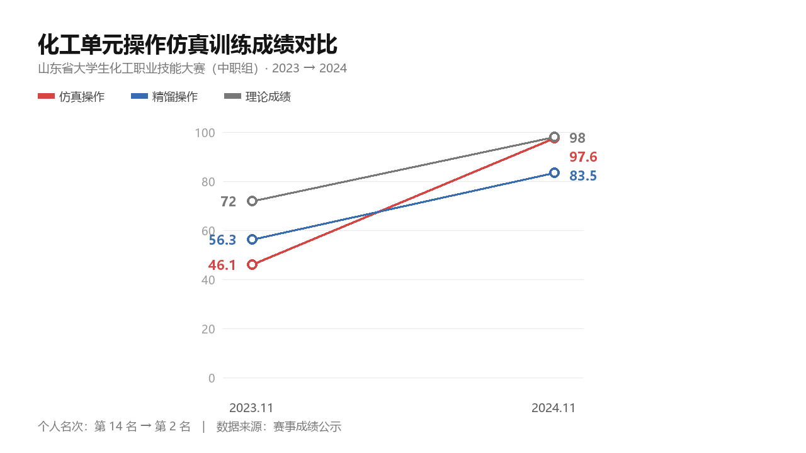

# 化工单元操作仿真训练复盘库

> 一套面向化工单元仿真（化工总控工方向）的**个人训练与复盘方法**。
> 覆盖 10 个工艺单元、29 组带「耗时 + 得分」的场景记录，以及 2023 → 2024 两个赛季的成绩对比。



| 指标 | 2023.11 | 2024.11 |
|---|---|---|
| 仿真操作 | 46.10 | **97.6** |
| 精馏操作 | 56.3 | **83.5** |
| 个人名次 | 第 14 名 | **第 2 名** |
| 奖项 | 三等奖 | **一等奖** |

---

## 背景

2023 年第一次参赛，仿真单项 46.1 分，个人名次第 14。

那一年手上没有任何可继承的训练资料——上一届几乎没留下东西，题库、操作手册、经验笔记全都没有。所以真正的问题不是「练得不够多」，而是：

> **不知道自己错在哪。**

仿真软件只告诉你总分，不告诉你哪一步扣的分、为什么扣。反复刷，分数会缓慢涨，但你永远不知道天花板在哪。

这一年我做的事，本质上是把「刷分」变成「可解释的迭代」。

---

## 方法

### 1. 先读评分逻辑，再动手练

第一步不是练操作，是把评分系统的构成摸清楚。

拆完之后有一个关键发现：**评分里相当大一部分是「质量分」，考的不是操作速度，而是稳态维持能力**——参数落在区间内就持续给分，超出区间就掉分。

这意味着两件事：

- 从零开始涨分，最后分数一定不高（因为进入区间太晚）
- 真正该优化的是**「多快进入稳态」**，而不是「多快做完」

### 2. 重构操作序列：稳态优先

据此把整套操作序列重新设计了一遍：

```
原思路：按步骤顺序做完 → 参数自然会到位
新思路：先锁定影响稳态的关键参数 → 提前建立稳态 → 再进入考核窗口
```

**「先建立稳态，再进入考核窗口」** 这个思路，在真实化工开车操作里本来就是标准做法——只是仿真里没人告诉你它值分。

### 3. 全程录屏 + 归档 + 量化复盘

每次操作全程录屏，文件名直接编码**场景 + 耗时 + 得分**：

```
固定床/反应器超温25秒99.5.mp4
流化床/流化床冷态开车12分半99.99.mp4
co2压缩机/co2压缩机停车两分半100.mp4
```

文件名本身就是一条数据记录，可以批量解析成表格（见 scripts/parse_logs.py）。
累计 400 余个操作录屏、约 13 GB，按工艺单元分目录归档。

复盘时不是「再看一遍视频」，而是：

1. 按单元捞出全部记录
2. 找出**同场景下耗时最长 / 得分最低**的那几次
3. 逐帧对比「高分那次」和「低分那次」的操作差异
4. 定位到具体哪一步慢了、哪个参数漏了

---

## 数据

- data/competition.csv — 两个赛季的正式比赛成绩
- data/scenarios.csv — 29 组场景的耗时与得分（从录屏文件名解析）
- docs/library-structure.md — 复盘库的目录结构与命名规范
- docs/skills.md — 从训练中提炼出的可迁移能力清单

---

## 这套方法能迁移到哪

不是「仿真技巧」，是三件通用的事：

1. **面对不透明的评分系统，先逆向分析规则，再优化策略**——比赛、考试、评审、KPI，都是同一个结构
2. **用录屏 / 日志建立可回溯的记录**，把「感觉不对」变成「第 3 分 12 秒那一步慢了」
3. **在封闭系统里先建立可控状态，再暴露给评价**

---

## 说明

- 本仓库**不包含**原始操作录屏（约 13 GB）与赛事题库，仅保留方法、数据结构与解析脚本
- 数据均为个人训练记录，成绩以赛事官方公示为准
